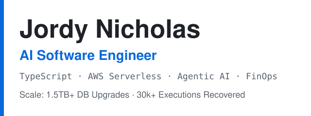

<picture>
  <source media="(prefers-color-scheme: dark)" srcset="assets/header-dark.svg">
  
</picture>

> **Generative AI & Cloud-Native Distributed Systems**  
> [LinkedIn](https://www.linkedin.com/in/jordy-nicholas) · [jordyncdasilva@live.com](mailto:jordyncdasilva@live.com) · Cruzeiro, São Paulo, Brazil
>  
> [CV-EN](https://drive.google.com/file/d/1LwjgjrglEJifuTFHDk61zuoUpK8rDTsm/view?usp=drive_link) · [CV-PT-BR](https://drive.google.com/file/d/1cgfYR9l_Ojt3Pe6BAPt35pC3CAeOThSw/view?usp=drive_link) 

 

## About Me

I build autonomous agents, AI-powered developer tooling, and secure local-first applications. My approach to AI engineering is deeply rooted in my background building highly concurrent, mission-critical AWS serverless backend systems for US-based B2B platforms. I leverage my experience with strict SLAs, zero-downtime database migrations, and cloud reliability to architect AI workflows that are deterministic, cost-efficient, and production-ready.
## About Me
I build autonomous agents, AI-powered developer tooling, and secure local-first applications. My approach to AI engineering is deeply rooted in my background building highly concurrent, mission-critical AWS serverless backend systems for US-based B2B platforms. I leverage my experience with strict SLAs, zero-downtime database migrations, and cloud reliability to architect AI workflows that are deterministic, cost-efficient, and production-ready.

## Core Engineering Philosophy

* **Strict Type Safety over Flexibility:** I enforce strict TypeScript configurations, avoid the `any` type, and leverage Zod for runtime schema validation to catch errors at the boundary.
* **Architecture Pragmatism:** I favor modular monoliths (e.g., Fastify + Prisma) for standalone applications to avoid premature microservice overhead, reserving event-driven distributed architectures for high-throughput cloud constraints.
* **Cost & Observability First:** From AI token usage to AWS execution times, I design systems with built-in FinOps awareness and explicit logging layers. Production changes always ship with a rollback path.

## AI Engineering & Open Source

### Intro | *Privacy-First AI Career Studio*
A desktop-first application studio that generates grounded, role-fit CVs and cover letters without relying on blind LLM hallucinations or opaque SaaS platforms.
* **Architecture (Hexagonal):** Built on a strict Ports and Adapters architecture where the core domain (`Profile`, `Application`, `DocumentDraft`) never imports external frameworks. 
* **Stack:** Deployed as a desktop app via Tauri 2 and SvelteKit, leveraging Bun, Valibot for strict schema validation, and Drizzle with libSQL/Turso for dual-write storage.
* **AI BYOK:** Integrates a Bring-Your-Own-Key model supporting local Ollama inference, Gemini, OpenAI, or a desktop CLI. Prompts are strictly grounded to user data via TipTap and custom PDF/DOCX parsers, preventing the model from inventing skills or employers.

### TokenForge | *AI FinOps & Token Optimization*
An enterprise toolchain (CLI, VS Code extension, and React dashboard) designed to audit and slash token waste in coding-agent workflows (Copilot, Cursor, Claude, Gemini).
* **Under the Hood:** Operates primarily via a heuristic parsing engine that scores repository context risk without incurring expensive LLM calls. It generates tool-specific Policy Packs and provides cryptographic Savings Proofs, offering clear ROI metrics for teams scaling AI developer tools.

### SpecWright | *Deterministic Multi-Agent Orchestration*
An autonomous system that transforms raw product intent into structured, cited engineering SpecPacks, outputting requirements, architecture options, and risk assessments.
* **Under the Hood:** Engineered with Python, FastAPI, LangGraph, and CrewAI. It bypasses standard LLM unpredictability by implementing a hybrid Retrieval-Augmented Generation (RAG) pipeline with strict agentic guardrails, ensuring the orchestration yields reliable, production-ready specifications.

### Keynest | *Self-Hostable Cryptographic Vault*
An embeddable password tool and Vault Manager that standardizes enterprise cryptographic policies, eliminating reliance on black-box SaaS.
* **Under the Hood:** Engineered as a strict Maven multi-module monorepo using Java 21 LTS, Spring Boot, and Angular. It features decoupled, first-party libraries implementing AES-256-GCM and Argon2id, ensuring high-compliance data protection.

### Monokit (API & Web) | *Modular Monolith Boilerplate*
A reference architecture for scalable, standalone SaaS applications prioritizing strict type safety and domain boundaries.
* **Under the Hood:** The backend (`Monokit-API`) is a Fastify, Prisma, and PostgreSQL modular monolith featuring multi-tenant authentication and internal queues. The frontend (`Monokit-Web`) is a Next.js console built with TypeScript that strictly consumes the OpenAPI contract generated by the backend, ensuring zero drift between API boundaries and UI state.
## Cloud Reliability & Backend Operations

Before dedicating my focus to AI tooling, I owned fullstack reliability for high-compliance identity validation platforms in the US market (Encora / Coforge).

* **Zero-Downtime Migrations:** Orchestrated a PostgreSQL upgrade from 15.12 to 17.7 on a 1.5TB+ Amazon Aurora database, executing a strict Blue/Green deployment under tight compliance deadlines.
* **Distributed System Recovery:** Architected a stateful, recursive AWS Lambda workflow using AWS SDK v3 to bypass enterprise concurrency limits, successfully batch-terminating 30,000+ stuck Step Functions executions and reducing environment recovery from 5 days to under 4 hours.
* **Secure B2B Pipelines:** Built automated event-driven ETL pipelines (S3, EventBridge, Step Functions) and custom Lambda Authorizers integrating OpenSSL and AWS Secrets Manager for government-grade data consumption.
* **Process Leadership:** Prior to software engineering, I led continuous improvement initiatives at Iochpe-Maxion, delivering over BRL 11 million in accumulated operational savings.

## Technical Arsenal

| Domain | Technologies |
| :--- | :--- |
| **AI Engineering** | LangChain, LangGraph, CrewAI, RAG, Multi-Agent Systems, Model Context Protocol (MCP), Cursor, Gemini |
| **Backend / Core** | TypeScript, Node.js, Java, Python, Spring Boot, Fastify, REST APIs, Clean Architecture |
| **Cloud (AWS)** | Lambda, API Gateway, Step Functions, SQS, S3, EventBridge, CloudFormation, CDK |
| **Data & Storage** | PostgreSQL, Prisma, Amazon Aurora, DynamoDB, MySQL |
| **Frontend** | React.js, Next.js, Angular, Vite, SvelteKit, Tauri |
